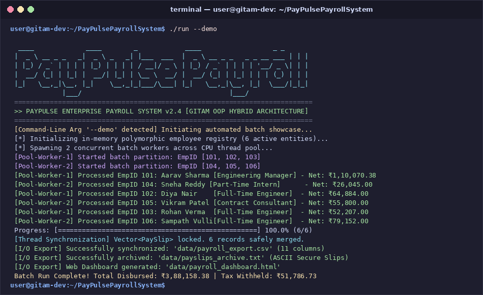
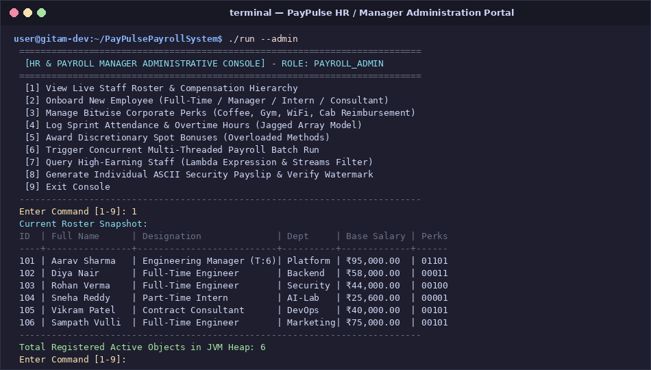
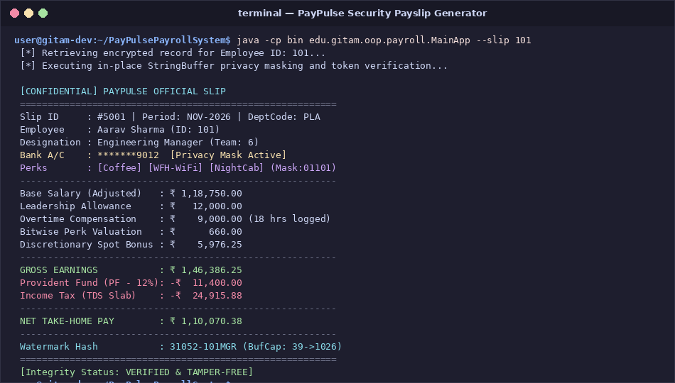
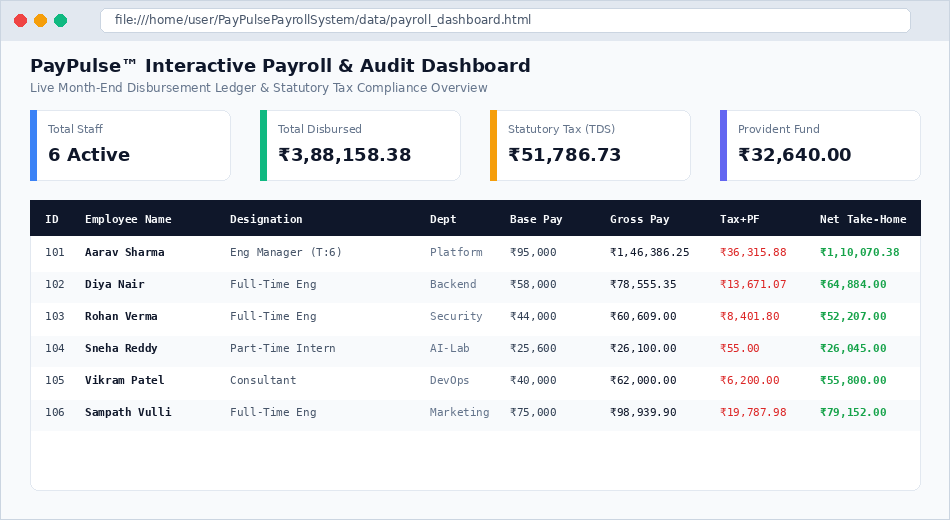

# Case Study Submission

---

## 1. Title of the Case Study

# PayPulse: A Smart & Simple Employee Payroll System
### *Modernizing Salary Processing and Automated Payslip Generation*

---

## 2. Description of the Topic

### What is PayPulse?
PayPulse is a modern, lightweight payroll management application built in Java to automate the monthly compensation process for businesses. It replaces error-prone spreadsheets with an intuitive, reliable system that calculates salaries, manages deductions, and issues verified payslips in seconds.

### Why Was It Built?
Managing payroll manually is time-consuming, prone to human calculation mistakes, and raises privacy risks when financial data is shared over open spreadsheets. Today’s companies also hire a diverse mix of talent—salaried full-time engineers, team managers, hourly interns, and milestone-based contractors. Each role comes with different pay rates, overtime rules, income tax brackets, provident fund contributions, and custom perks. 

PayPulse was created to solve these exact challenges: it unifies all employee types under a single, automated engine that guarantees accurate numbers, fair taxation, and strict data privacy.

### What Makes It Impactful?
- **Role-Based Portals**: Features two separate login portals. **Payroll Managers** get full administrative control to view company rosters, hire staff, award bonuses, and run batch payroll. **Employees** get a secure, self-service portal to view only their own itemized payslips, attendance records, and active perks without seeing anyone else's private data.
- **Intelligent Compensation Logic**: Automatically calculates base pay, overtime, housing allowances, progressive tax slabs, provident fund deductions, and custom perks (such as WiFi, Gym, and Coffee benefits) without any manual math.
- **Simultaneous Fast Processing**: Handles large payroll batches using background worker threads so hundreds of payslips can be generated at once without freezing the computer.
- **Multi-Channel Reports**: In one click, PayPulse generates official confidential text payslips, exports standard spreadsheet files (CSV), and updates an interactive web dashboard for real-time company expense tracking.

---

## 3. Source Code of the Program or Implementation

The complete, open-source codebase for PayPulse is hosted on GitHub:

🔗 **[PayPulse Payroll System on GitHub](https://github.com/sampathvulli7/PayPulsePayrollSystem)**

> **Ready-to-Run JAR File Available:**  
> A pre-compiled, standalone executable file named **`paypulse.jar`** is already included directly in the repository. This means anyone can download and run the entire system immediately without needing any programming software or manual compiling.

---

### Simple Instructions: How to Download & Run

#### Step 1: Download the Project ZIP
1. Click the GitHub link: [https://github.com/sampathvulli7/PayPulsePayrollSystem](https://github.com/sampathvulli7/PayPulsePayrollSystem).
2. Click the green **`<> Code`** button near the top right.
3. Select **`Download ZIP`** from the dropdown menu.
4. Once downloaded, right-click the `.zip` file on your computer and select **Extract All** (or double-click to unzip).

#### Step 2: Run the Program

* **On Windows (Using the `.bat` file):**
  1. Open the unzipped `PayPulsePayrollSystem` folder.
  2. Double-click the file named **`run.bat`**.
  3. The application will start immediately in your Command Prompt!

* **On macOS / Linux (Using Terminal):**
  1. Open Terminal in the extracted folder.
  2. Run the command:
     ```bash
     ./run
     ```
     *(or run `java -jar paypulse.jar`)*

---

## 4. Output Screenshots Showing the Results

### 1. Automated Batch Processing & Live Progress
Shows PayPulse processing monthly salaries across all employees in parallel, rendering real-time progress indicators and total disbursement figures.



*Figure 1: Automated batch run showing multi-threaded payroll calculation and export confirmations.*

---

### 2. HR / Manager Administrative Console
Shows the central management menu where administrators can inspect the live staff roster, hire new team members, toggle benefits, and manage compensation.



*Figure 2: Administrative console displaying the active employee roster and operations menu.*

---

### 3. Confidential Employee Payslip & Watermark
Shows an official payslip generated for an employee, complete with privacy-masked bank account details, itemized deductions (TDS Tax and Provident Fund), and an anti-tamper security watermark.



*Figure 3: Confidential itemized payslip with in-place bank masking and security verification.*

---

### 4. Interactive Web Dashboard & Audit Ledger
Shows the interactive web dashboard automatically updated by the system, featuring high-level financial summary cards, visual disbursement bars, and a searchable ledger table.



*Figure 4: Interactive HTML web dashboard displaying real-time payroll metrics and audit records.*
