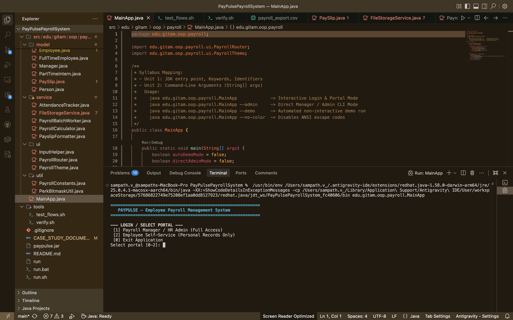
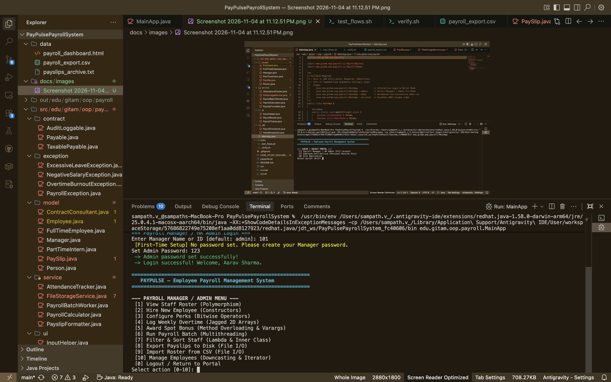
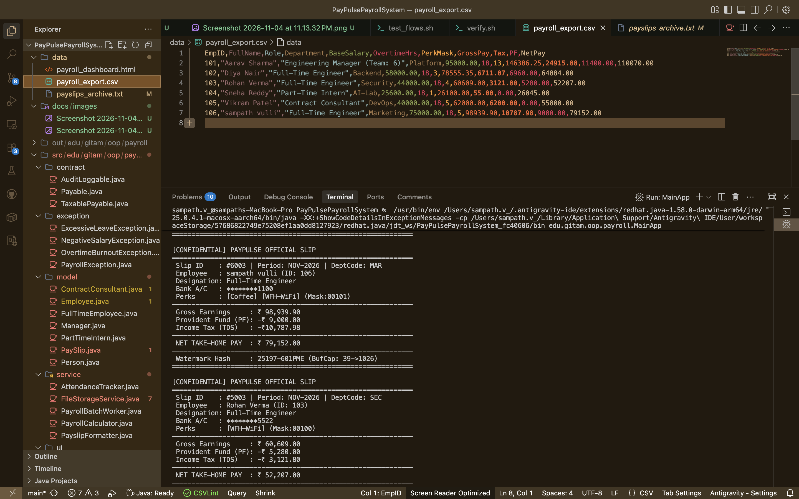
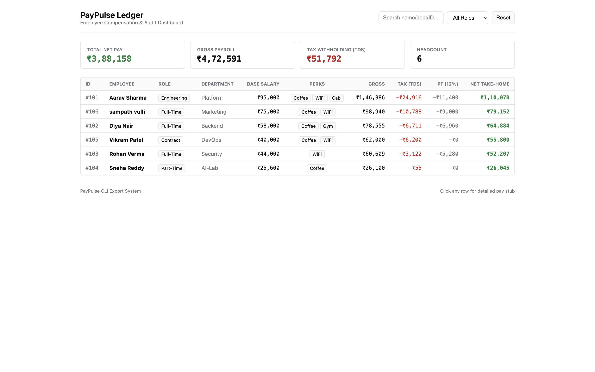

# Case Study Submission

---

## 1. Title of the Case Study

# PayPulse: A Smart & Simple Employee Payroll System
### *Modernizing Salary Processing and Automated Payslip Generation*

---

## 2. Description of the Topic

### What is PayPulse?
PayPulse is a modern, lightweight payroll management application built in Java to automate the monthly compensation process for businesses. It replaces error-prone spreadsheets with an intuitive, reliable system that calculates salaries, manages deductions, and issues verified payslips in seconds.

### Why Was It Built?
Managing payroll manually is time-consuming, prone to human calculation mistakes, and raises privacy risks when financial data is shared over open spreadsheets. Today’s companies also hire a diverse mix of talent—salaried full-time engineers, team managers, hourly interns, and milestone-based contractors. Each role comes with different pay rates, overtime rules, income tax brackets, provident fund contributions, and custom perks. 

PayPulse was created to solve these exact challenges: it unifies all employee types under a single, automated engine that guarantees accurate numbers, fair taxation, and strict data privacy.

### What Makes It Impactful?
- **Role-Based Portals**: Features two separate login portals. **Payroll Managers** get full administrative control to view company rosters, hire staff, award bonuses, and run batch payroll. **Employees** get a secure, self-service portal to view only their own itemized payslips, attendance records, and active perks without seeing anyone else's private data.
- **Intelligent Compensation Logic**: Automatically calculates base pay, overtime, housing allowances, progressive tax slabs, provident fund deductions, and custom perks (such as WiFi, Gym, and Coffee benefits) without any manual math.
- **Simultaneous Fast Processing**: Handles large payroll batches using background worker threads so hundreds of payslips can be generated at once without freezing the computer.
- **Multi-Channel Reports**: In one click, PayPulse generates official confidential text payslips, exports standard spreadsheet files (CSV), and updates an interactive web dashboard for real-time company expense tracking.

---

## 3. Source Code of the Program or Implementation

The complete, open-source codebase for PayPulse is hosted on GitHub:

🔗 **GitHub Repository:**  
**[https://github.com/sampathvulli7/PayPulsePayrollSystem](https://github.com/sampathvulli7/PayPulsePayrollSystem)**  
*(Direct URL: `https://github.com/sampathvulli7/PayPulsePayrollSystem`)*

> **Pre-compiled Executable JAR Available:**  
> A ready-to-run file named **`paypulse.jar`** is included directly in the repository. This means anyone can download and run the entire application immediately without needing to install developer software or compile any code.

---

### Simple Instructions: How to Download & Run

#### Step 1: Download the Project ZIP
1. Open the GitHub repository: **[https://github.com/sampathvulli7/PayPulsePayrollSystem](https://github.com/sampathvulli7/PayPulsePayrollSystem)**.
2. Click the green **`<> Code`** button near the top right of the page.
3. Select **`Download ZIP`** from the dropdown menu.
4. Once downloaded, right-click the `.zip` file on your computer and select **Extract All** (or double-click to unzip).

#### Step 2: Run the Program

* **On Windows (Using the `.bat` file):**
  1. Open the unzipped `PayPulsePayrollSystem` folder.
  2. Double-click the file named **`run.bat`**.
  3. The application will launch immediately inside your Command Prompt window!

* **On macOS / Linux (Using Terminal):**
  1. Open Terminal inside the extracted folder.
  2. Type the following command and press Enter:
     ```bash
     ./run
     ```
     *(or run `java -jar paypulse.jar`)*

---

## 4. Output Screenshots Showing the Results

### Screenshot 1: Role-Based Portal Selection & Secure Gateway
Shows the initial welcoming terminal interface upon starting the PayPulse application.



#### Description & Tutorial:
* **What you see:** When PayPulse is launched, it displays the main system banner and immediately prompts the user to select their role:
  * **Option [1]: Payroll Manager / HR Admin** (Full administrative privileges)
  * **Option [2]: Employee Self-Service** (Restricted, personal access only)
  * **Option [0]: Exit Application**
* **How it works:** This acts as the frontline security gate. Normal employees and interns cannot bypass this screen to inspect company-wide finances. Selecting an option seamlessly routes the user to the appropriate authentication flow.

---

### Screenshot 2: HR / Payroll Manager Console & Authentication
Shows a successful administrative login leading to the comprehensive management dashboard.



#### Description & Tutorial:
* **What you see:** The terminal shows the Payroll Administrator logging in, setting/verifying credentials, and accessing the **Full 10-Option Administrative Menu**.
* **Key Operations Available:**
  1. **View Staff Roster:** Displays active employees, salary structures, and live audit records.
  2. **Hire New Employee:** Onboards Full-Time Engineers, Managers, Interns, or Consultants.
  3. **Configure Perks:** Interactively toggles Coffee, Gym, WiFi, and Cab allowances using compact bitwise masks.
  4. **Log Weekly Overtime:** Records sprint attendance and overtime in irregular work-week matrices.
  5. **Award Spot Bonus:** Grants discretionary bonuses (flat amount, percentage, or multi-award bundles).
  6. **Run Payroll Batch:** Triggers background multi-threaded calculation with live progress bars.
  7. **Filter & Sort Staff:** Ranks staff by net take-home pay or filters high earners using lambda predicates.
  8. **Export Payslips to Disk:** Writes CSV spreadsheets, ASCII slip archives, and syncs the web dashboard.
  9. **Import Roster from CSV:** Reconstructs employee objects from an external CSV file.
  10. **Manage Employees:** Search staff by keyword, promote engineers to managers, or remove records.

---

### Screenshot 3: Confidential Employee Payslip & CSV Disk Archive
Shows the generated ASCII payslip in the terminal with the exported `payroll_export.csv` file open in the editor.



#### Description & Tutorial:
* **What you see:** The terminal outputs a clean, official payslip formatted for privacy and audit compliance:
  * **Privacy Protection:** Bank account numbers are masked in-place (e.g., `********8811`).
  * **Department & Perks:** Automatically extracts 3-letter department codes (e.g., `BAC`) and lists active benefits (`[Coffee] [Gym]`).
  * **Transparent Deductions:** Itemizes Gross Earnings, Provident Fund (12%), and Progressive Tax (TDS) to arrive at the final **Net Take-Home Pay**.
  * **Anti-Tamper Watermark:** Appends a dynamic security hash (`48846-201PME`) generated from the employee's ID and net earnings.
  * **Disk Export:** In the editor background, `data/payroll_export.csv` demonstrates that all 11 columns of financial data are synchronized to disk for corporate records.

---

### Screenshot 4: Interactive Web Dashboard & Audit Ledger
Shows the interactive web dashboard automatically updated by the PayPulse export engine.



#### Description & Tutorial:
* **What you see:** Opening `data/payroll_dashboard.html` in any web browser opens a modern, responsive compensation dashboard:
  * **Live KPI Cards:** Displays high-level totals including **Total Net Pay** (`₹3,88,158`), Gross Obligations, Total Tax Withholding, and Active Headcount.
  * **Interactive Staff Ledger:** A clean, sortable table displaying all employees (such as Aarav Sharma, sampath vulli, Diya Nair, Vikram Patel) alongside their designations, base pay, gross pay, deductions, and net take-home salary.
  * **Instant Search & Filter:** A real-time search bar allows filtering by name, department, or employment type. Clicking any row opens an itemized pay-stub drawer.

---

## 5. Quick OOP Cheat-Sheet: How OOP Powers PayPulse

> ### 💡 OOP Concepts in Action (Student Quick Reference)
>
> * **🔒 Encapsulation (`Employee.java` & `Person.java`)**  
>   Sensitive fields (salaries, bank accounts, login passwords) are declared `private` and protected by getters, setters, and validation checks like `verifyPassword()`.
>
> * **🌳 Multilevel Inheritance (`Person` $\rightarrow$ `Employee` $\rightarrow$ `FullTimeEmployee` $\rightarrow$ `Manager`)**  
>   Builds a clean 4-tier hierarchy. Subclasses automatically inherit personal and employee details from parent classes while adding role-specific fields (like `teamSize` for Managers or `hourlyRate` for Interns).
>
> * **🎭 Polymorphism & Dynamic Dispatch (`PayrollRouter.java`)**  
>   We store different employee types inside a single `List<Employee>`. Calling `emp.calculateNetPay()` automatically executes the exact formula for that specific role (Manager, Engineer, Intern, or Consultant) at runtime without rigid `if-else` blocks.
>
> * **🧩 Abstraction & Interfaces (`Payable.java`, `TaxablePayable.java`, `AuditLoggable.java`)**  
>   `Employee` is an `abstract class` specifying mandatory template methods (`getRoleTitle()`), while interfaces define clean compensation contracts and nested audit integrity checks.
>
> * **⚡ Core Systems Highlights:**  
>   * **Bitwise Perks (`PerkBitmaskUtil.java`):** Packs 4 benefit flags into a single 32-bit integer mask using `&`, `|`, `^`, and `<<` (left-shift doubles Manager allowances).
>   * **Jagged 2D Arrays (`Employee.java`):** Uses variable-length sub-arrays (`int[][]`) to capture real-world sprint weeks with different numbers of working days.
>   * **Multithreading (`PayrollBatchWorker.java`):** Divides the employee roster across concurrent background worker threads to process payslips in parallel safely.

---

## 6. Project Team Members

| S.No. | Group Member Name | University Roll No. |
| :---: | :--- | :---: |
| 1 | **Sampath Vulli** | `2025019557` |
| 2 | **Karanam Balaji Sreekar** | `2025215940` |
| 3 | **RV. Karthik** | `2025022897` |
| 4 | **B. Sankranth** | `2025016342` |
| 5 | **Shaik Jinna** | `2025016258` |
